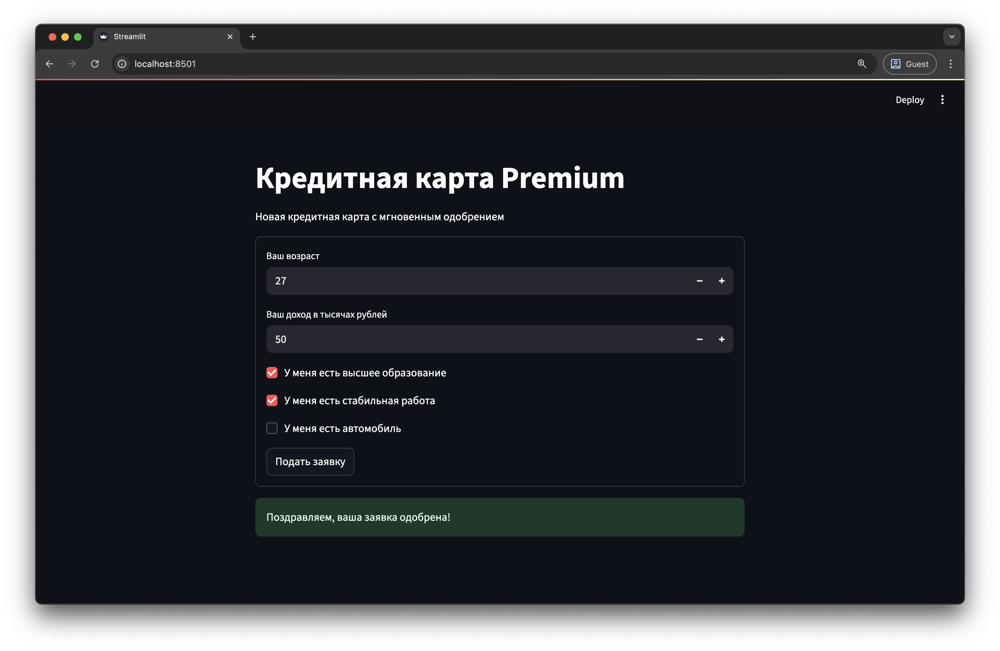

# Сервис скоринга



## Подготовка

Клонируем репозиторий:
```shell
git clone https://github.com/E4x7k/test-prg.git
```

Перед запуском сервиса скоринга и формы заявки нужно выполнить следующие шаги:

* Создайте папку `data` в корне проекта и скопируйте в нее файл `scoring.csv`.

* Создайте виртуальное окружение и установите зависимости.

```shell
uv sync
```

* Обучите модель скоринга (не забудьте активировать виртуальное окружение):

```shell
python train.py
```

Проверьте метрики модели и убедитесь, что в папке model появился файл `model.pkl`.

## Сервис скоринга

Запустите сервис скоринга из папки backend:

```shell
cd .\backend\
uvicorn main:app
```

Запустите Streamlit-интерфейс (в данном случае использую второе окно терминала):
```shell
cd .\client\
streamlit run app.py
```

